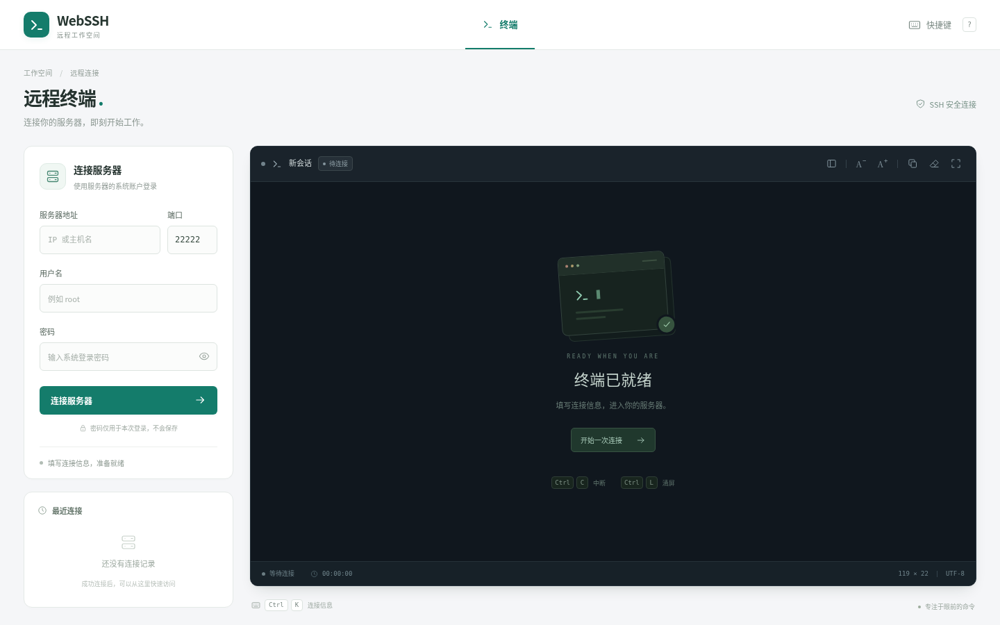
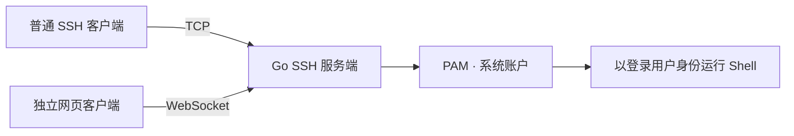

<div align="center">

# WebSSH Server

**一个 Go SSH 服务端，一个独立网页终端。**

使用服务器的系统账户，连接熟悉的命令行。

[](https://github.com/kadbbs/websshserver/actions/workflows/release.yml)
[](https://go.dev/)
[](https://github.com/kadbbs/websshserver/releases/latest)
[](LICENSE)

[快速开始](#快速开始) · [下载](https://github.com/kadbbs/websshserver/releases) · [配置文档](docs/configuration.md) · [问题反馈](https://github.com/kadbbs/websshserver/issues)

</div>



## 特性

- **标准 SSH** — 普通 OpenSSH 客户端可以直接登录，支持 Shell、远程命令及公钥认证。
- **两种连接入口** — Go 服务端同时接受 TCP 和 WebSocket，直接处理 SSH 2.0 协议。
- **系统账户登录** — 通过 PAM 认证，Shell 使用登录用户的 UID、GID、用户组、HOME 和登录 Shell。
- **独立单文件网页** — 下载 `ssh-client.html` 即可使用，无 npm、CDN、WASM 或第三方 JS 依赖。
- **顺手的终端体验** — 中文输入、终端缩放、最近连接、字号调节、全屏，以及手机快捷键。
- **服务器身份确认** — 校验主机签名和指纹；最近连接只保存地址、端口和用户名。

## 快速开始

### 1. 下载

从 [Releases](https://github.com/kadbbs/websshserver/releases/latest) 下载对应平台的压缩包，或单独下载网页客户端：

| 文件 | 用途 |
| --- | --- |
| [`websshserver_linux_amd64.tar.gz`](https://github.com/kadbbs/websshserver/releases/latest/download/websshserver_linux_amd64.tar.gz) | Linux x86-64 服务端与网页客户端 |
| [`websshserver_linux_arm64.tar.gz`](https://github.com/kadbbs/websshserver/releases/latest/download/websshserver_linux_arm64.tar.gz) | Linux ARM64 服务端与网页客户端 |
| [`ssh-client.html`](https://github.com/kadbbs/websshserver/releases/latest/download/ssh-client.html) | 可独立使用的单文件网页 |
| [`SHA256SUMS.txt`](https://github.com/kadbbs/websshserver/releases/latest/download/SHA256SUMS.txt) | 发布文件的 SHA-256 校验值 |

服务端面向 **Linux / glibc**，运行时需要 PAM。Debian / Ubuntu 可安装 `libpam0g`、`libpam-modules`；默认读取 `/etc/pam.d/sshd`。缺少该策略时，按[配置文档](docs/configuration.md#pam-与系统账户)安装随包提供的示例。

### 2. 启动

以 `amd64` 为例，解压后启动：

```bash
tar -xzf websshserver_linux_amd64.tar.gz
cd websshserver_linux_amd64

# 系统账户认证和用户权限切换需要 root。
# -origin null 允许直接打开本地 HTML 客户端。
sudo ./bin/sshserver -origin null
```

| 连接方式 | 默认端口 |
| --- | --- |
| 普通 SSH 客户端 | `22`；已占用时自动尝试 `22223` |
| 网页客户端 | `22222` |

实际监听地址会输出到启动日志。显式设置 `-tcp` 后使用指定端口，不再自动切换。

### 3. 连接

**网页客户端：** 打开随包的 `client/ssh-client.html`，填写以下信息：

```text
服务器地址  127.0.0.1
端口        22222
用户名      服务器上的系统用户名
密码        该系统用户的密码
```

**普通 SSH 客户端：** 根据启动日志选择实际端口：

```bash
ssh 系统用户名@127.0.0.1

# 默认 22 被占用、日志显示使用备用端口时：
ssh -p 22223 系统用户名@127.0.0.1
```

首次连接时，将客户端显示的指纹与服务端日志中的 `fingerprint=SHA256:...` 核对。

<details>
<summary><strong>从其他机器连接 / 自定义端口</strong></summary>

默认仅监听回环地址。需要从其他机器访问时，显式设置监听地址，例如：

```bash
sudo ./bin/sshserver -tcp :22223 -http :22222 -origin null
```

网页填写服务器 IP 和端口 `22222`；普通客户端使用 `ssh -p 22223 系统用户名@服务器IP`。两个端口均可自定义。

通过网站托管网页时，可设置 `-origin https://terminal.example.com`。HTTPS 网页需要连接配置了 TLS 的服务端，详见 [HTTPS / WSS](docs/configuration.md#https--wss)。

</details>

## 从源码构建

需要 Go 1.26+、C 编译器、Make 和 PAM 开发包。

```bash
git clone https://github.com/kadbbs/websshserver.git
cd websshserver

# Debian / Ubuntu
sudo apt-get install build-essential libpam0g-dev
make build

sudo ./bin/sshserver -origin null
```

构建产物为 `bin/sshserver`。网页已随源码提供；修改网页后运行 `make bundle-client` 更新单文件版本。

## 工作方式



网页在浏览器中完成 SSH 握手、主机校验和加解密。服务端提供 `/ssh` 与 `/healthz`，网页可以单独复制、托管和部署。

## 文档

| 文档 | 内容 |
| --- | --- |
| [配置与部署](docs/configuration.md) | 默认端口、监听地址、PAM、系统公钥、Origin 和 TLS |
| [协议与兼容性](docs/protocol.md) | 支持的 SSH 算法、终端能力与功能范围 |
| [开发与发布](docs/development.md) | 测试、单文件生成、本地打包与 tag 自动发布 |

当前支持交互式终端和远程命令；SFTP、端口转发、agent 转发及 X11 转发尚未实现。

## 自动发布

推送 tag 后，GitHub Actions 会执行检查和互通测试，再构建 Linux `amd64` / `arm64` 产物并创建 GitHub Release：

```bash
git tag -a v0.1.0 -m "v0.1.0"
git push origin v0.1.0
```

工作流接受所有 tag，推荐使用 `v0.1.0` 这样的版本号。发布包包含服务端、网页、文档、PAM 示例及许可证；独立网页和 SHA-256 校验文件也会作为附件提供。

## 参与贡献

欢迎提交 [Issue](https://github.com/kadbbs/websshserver/issues) 和 [Pull Request](https://github.com/kadbbs/websshserver/pulls)。提交代码前请运行 `make test check`；涉及网页或 SSH 协议的修改请同时运行浏览器互通测试。

## License

[MIT](LICENSE) © 2026 [kadbbs](https://github.com/kadbbs)

第三方组件保留各自的许可证，发布包中的 `THIRD_PARTY_LICENSES/` 收录 Go 运行时及服务端依赖的许可证。
